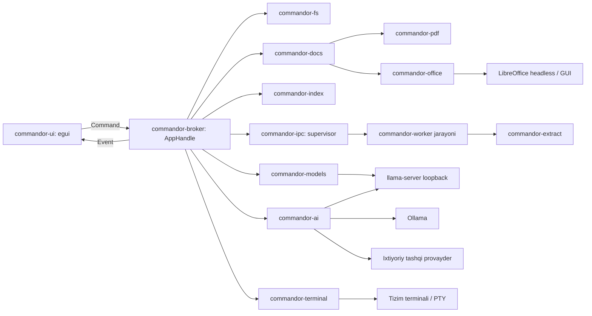
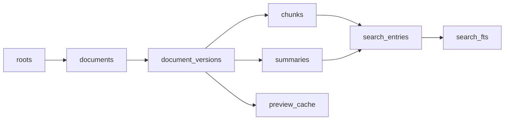

# Commandor — texnik loyiha (Rust)

Versiya: 2.0 · 2026-11-07. Hujjat maqsadli arxitekturani tasvirlaydi. 2026-11-07da foydalanuvchi qaroriga ko‘ra Electron/React/TypeScript prototipi to‘liq o‘chirildi va ilova **Rust**da qayta yoziladi ([ADR-001](#qarorlar-yozuvi)). 1-faza platforma asosi yozildi (eframe 0.35, wgpu backend); bajarilish holati [TODO](../TODO.md)da, talablarning asosiy manbasi [texnik topshiriq](TECHNICAL-SPEC.uz.md)da, API va ma’lumotlar modeli [kontraktlar](CONTRACTS.uz.md)da.

## Maqsad

Windows, macOS va Linux uchun Total Commander uslubidagi ikki panelli fayl menejeri. Fayl ko‘rish, tahrirlash, lokal qidiruv va AI bir ish maydonida ishlaydi. Internet aloqasi fayl boshqarish uchun talab qilinmaydi; bulut provayderi foydalanuvchi tanlagandagina ishlatiladi.

Rustga o‘tishdan kutilgan foyda (hali o‘lchanmagan, R0da tekshiriladi): bitta native binary, kichikroq distributiv va bazaviy RAM, native bindinglar bilan ABI muammosi yo‘qligi (SQLite, PTY, PDF), filesystem/jarayon kodida xotira xavfsizligi, UI threadni bloklamaydigan aniq concurrency modeli.

## Muhim aniqlik: Artcraft

Berilgan [storytold/artcraft](https://github.com/storytold/artcraft) loyihasi AI tasvir/video yaratish va 2D/3D sahna tuzish vositasi, DOCX/XLSX/PPTX uchun Office dvigateli emas. Foydalanuvchi Office uchun **LibreOffice asosidagi lokal integratsiyani tasdiqlagan**. Office adapteri almashtiriladigan trait bo‘ladi.

## Texnologik qaror

Quyidagi crate’lar **nomzod**; aniq versiyalar P1-01da `Cargo.lock` bilan pinlanadi, R0 spike natijasi bilan tasdiqlanadi yoki almashtiriladi. Tekshirilmagan crate tayyor yechim deb hisoblanmaydi.

| Qatlam | Tanlov (nomzod) | Izoh / R0 tekshiruvi |
|---|---|---|
| Til va build | Rust stable (MSRV P1-01da belgilanadi), Cargo workspace, `xtask` | Lokal muhitda cargo 1.94.1; uch OS CI kerak |
| GUI | `eframe`/`egui` (winit + wgpu yoki glow) | ADR-001: AccessKit orqali screen-reader, virtual jadval, immediate-mode zich UI. IME, katta matn va HiDPI R0da sinaladi; muvaffaqiyatsizlikda `iced` muqobili |
| Async va concurrency | `tokio` (IO/tarmoq), alohida OS threadlar (SQLite writer, copy workerlar), `crossbeam-channel` | UI thread hech qachon IO yoki og‘ir hisob kutmaydi |
| Serializatsiya | `serde`, `serde_json`, `toml` | Kontraktlar, worker protokoli, model manifestlari |
| Fayl tizimi | `std::fs`, `walkdir`/o‘z enumerator, `trash`, `notify` + debouncer, `sysinfo` (volume/RAM), `same-file`/platforma file-id | Savat, watcher va volume ro‘yxati uch OSda alohida sinaladi |
| Matn | `ropey` (rope buffer), `encoding_rs` + `chardetng`, `syntect` (highlight) | Katta fayl, BOM/EOL round-trip; o‘z editor widgeti |
| Markdown | `pulldown-cmark` → native egui render | HTML yo‘q, skript yo‘q; xom HTML matn sifatida ko‘rsatiladi yoki tashlanadi |
| YAML/JSON | `serde_json`, xavfsiz YAML parser (custom tag bajarmaydigan) | TXT-05 diagnostikasi |
| PDF ko‘rish | `pdfium-render` + PDFium dinamik kutubxonasi | Muqobil: `hayro` (sof Rust) yoki MuPDF (AGPL — litsenziya qarori kerak). R0.4da render sifati/tezligi solishtiriladi |
| PDF tahrir | `lopdf` (sahifa amallari), PDFium annotation API | PDF-02; matnni Word kabi qayta joylash scope’dan tashqari |
| Office | LibreOffice `soffice --headless --convert-to pdf`, private profil, argument massivi | Embedded uchun LibreOfficeKit C API (FFI) spike — R0.2/OFF-07 darvozasi |
| Office ajratish (indeks) | `zip` + `quick-xml` (DOCX/XLSX/PPTX), `calamine` (XLSX nomzodi) | Decompress/entry/nesting limitlari, DTD/entity o‘chiq |
| Indeks | `rusqlite` (`bundled`, FTS5) | Native ABI muammosi yo‘q; WAL, yagona writer thread |
| Terminal | Tizim terminali: OS launcher; ichki: `portable-pty` + `alacritty_terminal` (+ `egui_term` nomzodi) | TERM-02–04, R2 |
| HTTP/AI | `reqwest` (rustls), SSE/NDJSON stream parser | Ollama `/api/chat`, OpenAI-compatible `/v1/chat/completions` |
| Model yuklash | `reqwest` Range, `sha2`, `.part` fayl | Hugging Face API metadata schema bilan tekshiriladi |
| Maxfiy kalit | `keyring` (Keychain / Credential Manager / Secret Service) | Backend bo‘lmasa faqat sessiya xotirasi |
| i18n | `fluent-bundle`, `resources/i18n/{uz,ru,en}/*.ftl` | UX-06: matnlar kodga tarqoq yozilmaydi |
| Log | `tracing` + redaction qatlami | Kalit, prompt va fayl mazmuni yozilmaydi |
| Test | `cargo test`, `tempfile`, `proptest`, `insta` (snapshot), `wiremock` (HTTP mock) | Faqat sintetik vaqtinchalik fixturelar |
| Paketlash | `cargo-packager` yoki `cargo-dist` (MSI/NSIS, DMG/app, AppImage/deb) | Signing/notarization R3 |

## Jarayonlar modeli

Electron’dagi renderer/preload chegarasi o‘rniga Rustda **ikki darajali izolyatsiya** qo‘llanadi:

1. **Kompilyatsiya darajasida vakolat chegarasi.** `commandor-ui` crate’i `std::fs`, `std::process` va tarmoqqa bevosita kira olmaydi: unga faqat `commandor-core` turlari va `commandor-broker`ning typed `AppHandle` fasadi beriladi. Bu `clippy.toml` `disallowed-methods`/`disallowed-types` va CI’dagi dependency tekshiruvi (`cargo deny`/`cargo tree` qoidasi) bilan majburlanadi.
2. **Jarayon darajasidagi izolyatsiya.** Ishonchsiz kontent parserlari (PDF, OOXML, LibreOffice render) alohida `commandor-worker` jarayonida ishlaydi. Worker crash/timeout/OOM asosiy ilovani yopmaydi (NFR-06).

| Jarayon / thread | Vazifa | Hayot sikli va cheklov |
|---|---|---|
| UI thread (asosiy jarayon) | egui event loop, panellar, viewer, dialoglar | Hech qanday bloklovchi IO yo‘q; har kadr ichida faqat holat va eventlarni o‘qiydi |
| Broker (asosiy jarayon, tokio) | Commandlarni validatsiya, capability grantlar, routing, job scheduler | Ilova bilan; og‘ir parsing/hash yo‘q |
| File workerlar (threadlar) | Listing, copy/move, checksum, watch | Navbat bo‘yicha; cancel token va operation journal |
| Index writer thread | SQLite yagona yozuvchi, FTS, reconciliation | Ilova bilan; batch tranzaksiyalar; o‘quvchilar alohida ulanish |
| `commandor-worker` (child process) | Extraction, PDF rasterlash fallback, Office render orchestration | Talab bo‘yicha; job bo‘yicha timeout, xotira limiti (OS imkoni bo‘yicha), crashda qayta ishga tushadi |
| LibreOffice headless | Snapshotdan PDF render, text export | Private profil; render workeri boshqaradi; idle’da yopiladi |
| LibreOffice edit session | Working copy tahriri (R1 native oyna) | Faqat Editda; dirty session idle sabab yopilmaydi |
| PTY session | Ichki terminal (R2) | Har tab uchun; owned process tree |
| `llama-server` | Lokal generatsiya va health endpoint | Faqat foydalanuvchi/sozlama talabida; `127.0.0.1`; owned process |

Bitta binary ishlatiladi: `commandor` (GUI) va `commandor --worker <kind>` (child). Worker bilan aloqa: stdin/stdout ustida uzunlik prefiksli `serde` (JSON yoki `postcard`) freymlar, protokol versiyasi va har so‘rovda `jobId`. Katta ma’lumot (PDF sahifa rasmi, matn) vaqtinchalik faylga yoki chunklangan freymga yoziladi; bitta ulkan xabar yuborilmaydi.



### UI ↔ broker oqimi

UI `AppHandle::dispatch(Command) -> RequestId` chaqiradi va darhol qaytadi. Natija va progress `Event` kanali orqali keladi; broker eventdan keyin `egui::Context::request_repaint()` chaqiradi. UI holati (`AppState`) faqat eventlar bilan yangilanadi (Elm uslubi). Kechikkan eski javob `requestId`/generation orqali rad etiladi — yangi natijani bosib ketmaydi.

UI haqiqiy yo‘lni ko‘rsatadi, lekin amal uchun broker bergan opaque `EntryId`/`LocationId`/`DocumentId` ishlatadi. Foydalanuvchi kiritgan yo‘l yoki OS picker (`rfd`) natijasi broker orqali yangi grant yaratadi. AI tool doirasi foydalanuvchining joriy grantidan oshmaydi.

### Kontent xavfsizligi

Web engine yo‘q: fayl mazmuni hech qachon HTML/JS sifatida bajarilmaydi. Markdown native widgetlarga render qilinadi; xom HTML ko‘rsatilmaydi, tashqi rasmlar sukut bo‘yicha yuklanmaydi. AI javobi buyruq emas, tekshiriladigan ma’lumot. Tashqi dasturlar (`soffice`, `llama-server`, terminal) faqat argument massivi bilan ishga tushiriladi, shell orqali emas.

## Workspace tuzilmasi

Modul chegaralari. 2026-11-07 holati: `core`, `broker`, `ui`, `app`, `ipc`, `i18n` va `xtask` yaratilgan ([P1 hisoboti](reports/P1-rust-platforma.md)); `commandor-fs` listing/grant servisi va alohida file thread qo‘shildi ([P3-01a](reports/P3-01-rust-listing.md)). Hozir broker crossbeam + OS thread bilan ishlaydi; jadvaldagi tokio maqsadli yechim. Qolgan modullar o‘z fazasida qo‘shiladi va `xtask` `RULES` ro‘yxatiga yoziladi.

```text
Cargo.toml                     workspace, umumiy lint/profil sozlamalari
clippy.toml                    UI crate uchun disallowed fs/process/net
crates/
  commandor-app/               binary: main, eframe bootstrap, --worker dispatch
  commandor-ui/                egui ko‘rinishlari; faqat core + broker fasadi
  commandor-core/              ID, Revision, ErrorCode, Job, Event, Plan turlari
  commandor-broker/            AppHandle, grantlar, validatsiya, scheduler, routing
  commandor-fs/                listing, plan/execute, journal, save protokoli, trash, watch, volume
  commandor-docs/              format aniqlash, matn codec, document session, preview cache
  commandor-editor/            ropey buffer, undo/redo, find/replace, syntect highlight
  commandor-pdf/               PdfBackend trait, pdfium implementatsiyasi, lopdf sahifa amallari
  commandor-office/            LibreOffice probe/render/edit, LOK spike (feature flag)
  commandor-extract/           text/pdf/docx/xlsx/pptx extractorlar (workerda ishlaydi)
  commandor-index/             SQLite sxema/migratsiya, FTS5, scanner, reconciliation
  commandor-ai/                provider adapterlari, streaming, tool sxema, plan validatsiya
  commandor-models/            katalog, HF resolve, downloader, llama.cpp lifecycle
  commandor-terminal/          tizim terminali launcher, PTY sessiyalar
  commandor-ipc/               worker protokoli, process supervisor
  commandor-i18n/              fluent yuklash, til tanlash
resources/i18n/{uz,ru,en}/     .ftl matn resurslari
resources/model-catalog/       tekshirilgan model manifestlari (TOML)
xtask/                         fixture generatsiya, paketlash, lint yordamchilari
tests/platform/                Windows/macOS/Linux acceptance
docs/                          talab, ADR, hisobotlar
```

Bog‘liqlik yo‘nalishi: `ui → broker → (fs, docs, index, ai, models, terminal, ipc) → core`. To‘g‘ridan-to‘g‘ri bog‘liqliklar `cargo xtask check-boundaries` bilan tekshiriladi; UI crate’dagi fs/process/net chaqiruvlari [clippy.toml](../crates/commandor-ui/clippy.toml) va `#![forbid]` bilan rad etiladi. Servis crate’lari `ui` yoki `eframe`ga bog‘lanmaydi, shuning uchun ular GUIsiz test qilinadi va GUI almashtirilsa qayta ishlatiladi.

## Ikki bosqichli hujjat ochish

Holatlar: `closed → preview-loading → preview-ready → editor-loading → editing → saving → preview-stale → preview-ready`; har bosqichda `error` va qayta urinish mumkin.

1. Fayl turi extension va magic bytes orqali aniqlanadi (`commandor-docs`).
2. Matn — `commandor-editor` read-only rejimida; PDF — PDFium orqali sahifa teksturalari (virtual sahifalar, faqat ko‘rinayotganlari render). Office uchun versiyalangan preview cache tekshiriladi.
3. Cache yo‘q bo‘lsa worker LibreOffice headless’ni private profil bilan ishga tushirib, read-only snapshotni PDFga aylantiradi. Timeout bilan cheklanadi. Natija PDF viewer orqali ko‘rsatiladi. GUI editor ochilmaydi, ammo render dvigateli resurs ishlatadi.
4. Faqat **Tahrirlash** bosilganda muharrir ishga tushadi: matn uchun editor yozish rejimiga o‘tadi; Office uchun R1da boshqariladigan tashqi LibreOffice oynasi working copy bilan ochiladi. Bu embedded deb da’vo qilinmaydi.
5. Saqlanganda hash o‘zgarishi previewni eskirgan deb belgilaydi. Watcher debounce bilan qayta tekshiradi; yo‘qolgan eventlar qayta skan bilan aniqlanadi. Eski render natijasi yangi revisionni bosib ketmaydi.
6. Disk joyi tekshiruvi, konflikt, staging/fsync, atomik almashtirish, backup va recovery [save protokoli](CONTRACTS.uz.md#22-save-protokoli) bo‘yicha.

Makros bajarilmaydi. Preview uchun alohida profil va UNO/LOK load parametrlarida `MacroExecutionMode=NEVER_EXECUTE` talab qilinadi; faqat `--headless`ga tayanish yetarli emas. [LibreOffice MacroExecMode](https://api.libreoffice.org/docs/idl/ref/namespacecom_1_1sun_1_1star_1_1document_1_1MacroExecMode.html)

### Office session: snapshot, edit va commit

```mermaid
sequenceDiagram
  participant U as Foydalanuvchi
  participant V as UI viewer
  participant B as Broker
  participant W as Worker + soffice
  participant E as Edit session
  U->>V: Hujjatni ochish
  V->>B: Command::PreviewOpen(documentId)
  B->>B: Revision + cache tekshiruvi
  alt Cache topilmadi
    B->>W: Snapshotni PDFga render
    W-->>B: PDF + metadata
  end
  B-->>V: Event::PreviewReady(token)
  Note over E: Editor hali ishga tushmagan
  U->>V: Tahrirlash
  V->>B: Command::EditBegin(baseRevision)
  B->>E: Working copy + private profil
  E-->>B: Saved working revision
  B->>B: Original revision + konfliktni tekshirish
  alt Original o‘zgarmagan
    B->>B: Backup + atomik commit
    B-->>V: Yangi revision; preview invalidate
  else Original o‘zgargan
    B-->>V: Konflikt; Save As / compare / cancel
  end
```

R1 native oynada foydalanuvchi Save qilgach broker working copy o‘zgarishini aniqlaydi va UI **Asl faylga qo‘llash** holatini ko‘rsatadi. Native oynada boshqa manzilga Save As avtomatik original deb qabul qilinmaydi.

Preview cache kaliti: `content_sha256 + engine_version + render_options + font_environment_fingerprint`. Path/mtime faqat hint.

### Embedded Office darvozasi (OFF-07)

Rust/native GUI LibreOfficeKit bilan ishlashni Electron’ga qaraganda soddalashtirishi mumkin: LOK C API FFI orqali chaqiriladi, tile’lar bevosita egui teksturasiga chiziladi, klaviatura/IME/mouse eventlari LOK’ga uzatiladi. Bu **gipoteza**: LOK SDK’ni uch OSda tarqatish, IME, clipboard, selection, save va crash recovery R0.2 spike’ida isbotlanishi shart. Native LibreOffice oynasini Rust oynasiga “qo‘shib qo‘yish” yechim hisoblanmaydi. Uch OSda ishonchli natija bo‘lmasa OFF-07 ochiq qoladi; native fallback embedded deb nomlanmaydi.

`OfficeRenderer` va `OfficeEditor` trait’lari ajratilgan; LOK adapteri `lok` feature flag ortida.

## Fayl boshqarish

R1: mustaqil panellar va tablar, ko‘p tanlash, yashirin fayllar, nom filtri, volume ro‘yxati, virtual ro‘yxat (faqat ko‘rinadigan qatorlar chiziladi), copy/move navbati, rename, papka yaratish va savat. Listing oqimli: broker birinchi batchni darhol yuboradi, qolgani incremental keladi. Almashtirib yozish tasdiqsiz bajarilmaydi. Disklararo move: copy → hajm/hash tekshiruvi → manbani o‘chirish. F3 — ko‘rish, F4 — tahrirlash, F5 — nusxalash, F6 — ko‘chirish, F7 — papka, F8 — savat; klaviatura xaritasi sozlanadi.

## Qidiruv va qisqa mazmun

Faqat foydalanuvchi tanlagan rootlar indekslanadi. Symlinklar sukut bo‘yicha kuzatilmaydi. `.git`, `node_modules`, `target`, cache, credential kataloglari va katta/binar fayllar cheklanadi. Ruxsat berilmagan fayl butun ishni to‘xtatmaydi.



Pipeline: enumerate → extract (worker) → normalize → chunk → local summary → persist (writer thread) → search. SQLite foydalanuvchi app-data katalogida (`directories` crate), WAL rejimida, yagona writer bilan; migratsiyalar versiyalangan, oldidan backup. FTS jadvallari asosiy jadvallar bilan bitta tranzaksiyada yangilanadi. Uzun hujjat uchun har bo‘lak summarysi va yakuniy birlashtirish; coverage va provenance saqlanadi. Ma’lumotlar modeli [CONTRACTS](CONTRACTS.uz.md#7-saqlash-modeli)da.

Extraction formatga qarab: matn/kod — encoding detection, line locator; PDF — text layer va sahifa locator, skan bo‘lsa `needs_ocr`; DOCX — paragraf/jadval tartibi; XLSX — sheet/katak, formula va cached qiymat farqi; PPTX — slayd, shape, notes; legacy Office — limitlangan LibreOffice text export. ZIP/XML parserlarida hajm/entry/nesting/timeout limitlari, tashqi entitylar o‘chiq.

## AI yordamida boshqarish

Chat, tanlangan fayl summarysi va tabiiy tilda qidirishdan boshlanadi. Model JSON sxemaga mos reja qaytaradi: `list`, `search`, `preview`, `copy`, `move`, `rename`, `trash`, `mkdir`. Javob `serde` bilan qat’iy turga parse qilinadi (`deny_unknown_fields`), keyin broker root, symlink, revision va konfliktlarni qayta tekshiradi. Mutatsiya faqat foydalanuvchi ko‘rgan reja tasdiqlangandan keyin. Model erkin shell kodi hech qachon ishga tushirilmaydi.

Lokal summary uchun faqat loopback provayder; remote redirect va cloud fallback rad etiladi (`reqwest` redirect policy loopbackdan chiqishni bloklaydi). API kalitlari `keyring` orqali OS secret store’da. Hujjatdagi prompt injection vakolat bermaydi.

## Modellar va llama.cpp

Boshlang‘ich nomzod: [Qwen3.5-2B](https://huggingface.co/Qwen/Qwen3.5-2B), [Unsloth GGUF Q4_K_M](https://huggingface.co/unsloth/Qwen3.5-2B-GGUF/tree/main) — benchmarkdan o‘tmagan. Xotira bahosi: `vazn + context/KV + runtime + zaxira`.

Yuklash: katalog → repo/revision/fayl/litsenziya/hajm → foydalanuvchi boshlaydi → `.part` → hajm va SHA-256 → rename → installed. Cancel, resume (ETag/revision mos bo‘lsa), disk kvotasi.

Runtime: `llama-server` (foydalanuvchi o‘rnatgan yoki keyin bundled) → `Command` argument massivi → `--host 127.0.0.1 --port <bo‘sh port> --ctx-size 4096` → health-check → ready. Shutdown graceful → timeout → faqat owned process tree. Kelajakda `llama-cpp-2` kabi in-process binding alohida ADR bilan baholanadi; boshlang‘ich qaror alohida jarayon (crash izolyatsiyasi, backend tanlash erkinligi).

## Ishlar navbati va resurs chegaralari

Boshlang‘ich scheduler: 2 copy oqimi, 1 Office render, 2 extractor, 1 lokal inference. Foreground preview/chat fon indeks/summarydan ustun. Job holatlari: `queued → running → completed | failed | cancelled`; qo‘shimcha `paused`, `waiting-for-user`, `retrying`. Har job: `JobId`, owner, progress, `CancellationToken`, checkpoint va retry siyosati. Cancel stream/jarayonga real signal beradi, partial output nomlanadi yoki tozalanadi.

## Platformalar va qabul mezonlari

| Yo‘nalish | Qabul mezoni |
|---|---|
| Fayllar | Unicode/bo‘shliq yo‘llar; ruxsat xatosi; mavjud maqsadni tasdiqsiz almashtirmaslik |
| Matn | UTF-8 round-trip; ochilganidan beri o‘zgargan faylda konflikt; katta/binar faylda aniq xabar |
| Office | Render ochilganda GUI yo‘q; Edit bosilganda editor; saqlashdan keyin yangi preview |
| PDF | Ko‘p sahifa, zoom; buzilgan/parolli faylda xato; annotation scope alohida |
| AI | Ollama va llama.cpp mock contract; timeout; model yo‘q holati; kalit logga chiqmasligi |
| Qidiruv | Tanlangan rootdan chiqmaslik; symlink sikli yo‘q; restartdan keyin indeks saqlanishi |
| Model | Checksum xatosida installed emas; download cancel; localhost bind; start/stop |
| UI chegarasi | `commandor-ui`da fs/process/net chaqiruvi CI lint bilan rad etiladi |
| Release | Windows x64, macOS arm64/x64, Linux x64 (X11/Wayland) alohida build va smoke |

## Qarorlar yozuvi

| ADR | Qaror | Sabab | Oqibat / qayta ko‘rish sharti |
|---|---|---|---|
| 001 | **Rust + egui/eframe**, Electron/React/TS bekor qilindi (2026-11-07) | Foydalanuvchi talabi; bitta native binary, kamroq RAM, xavfsiz native qatlam, AccessKit | Web ekotizimi (CodeMirror, PDF.js, xterm.js) yo‘q — editor/PDF/terminal Rust crate’lari bilan quriladi. R0da IME/editor/a11y muvaffaqiyatsiz bo‘lsa `iced` prototipi |
| 002 | Alohida preview va edit session | Ikki bosqichli talab va failure isolation | Headless render ham og‘ir bo‘lishi mumkin; cache shart |
| 003 | LibreOffice adapteri | Foydalanuvchi tasdiqladi; lokal offline Office | Embedded LOK FFI va format mosligi prototipga bog‘liq |
| 004 | SQLite FTS5 (`rusqlite` bundled) | Katta indeks, tranzaksiya, lokal saqlash, ABI muammosiz | SQLite versiyasi crate bilan pinlanadi |
| 005 | Crate-darajali vakolat chegarasi + worker jarayoni | Renderer sandbox o‘rnini bosadi; parser crash izolyatsiyasi | Lint/CI qoidalari majburiy; worker protokoli versiyalanadi |
| 006 | llama.cpp alohida jarayon | Backend/buildni UIga bog‘lamaslik, resursni bo‘shatish | Runtime manifest, port/token va lifecycle menejeri kerak |
| 007 | AI faqat reja taklif qiladi | Fayl amallari deterministik va tekshiriladigan bo‘lishi | Action preview, revision check, audit zarur |
| 008 | Local-only avtomatik summary | Hujjatlar lokal qolishi talabi | Remote provider bilan summary queue ishlamaydi |
| 009 | PDF tahriri bosqichli | Matn layoutini qayta yaratish boshqa murakkablik | R2 annotation/page, full-content edit alohida scope |
| 010 | PDFium (`pdfium-render`) PDF backend nomzodi | Yetuk render, annotation API, BSD-uslub litsenziya | PDFium binarini har OS uchun tarqatish kerak; R0.4da `hayro`/MuPDF bilan solishtiriladi |
| 011 | O‘z matn editori (`ropey` + `syntect`) | egui `TextEdit` katta fayl va kod tahriri uchun yetarli emas | Ish hajmi katta; R1da minimal to‘plam, R2da kengaytirish |

## Tekshirilgan asosiy manbalar

Quyidagi manbalar 2026-11-06 tekshiruvida ko‘rilgan; Rust crate’lari 2026-11-07 qayta loyihalashda nomzod sifatida tanlandi va hali kod/benchmark bilan tasdiqlanmagan.

- [LibreOffice CLI](https://help.libreoffice.org/latest/en-US/text/shared/guide/start_parameters.html), [LibreOfficeKit manba daraxti](https://github.com/LibreOffice/core/tree/master/libreofficekit).
- [Ollama chat API](https://docs.ollama.com/api/chat), [llama.cpp server](https://github.com/ggml-org/llama.cpp/tree/master/tools/server).
- [Qwen model card](https://huggingface.co/Qwen/Qwen3.5-2B), [GGUF fayllari](https://huggingface.co/unsloth/Qwen3.5-2B-GGUF/tree/main), [Hub API](https://huggingface.co/docs/hub/api).
- [SQLite FTS5](https://sqlite.org/fts5.html).
- Rust nomzodlari: [egui](https://github.com/emilk/egui), [iced](https://github.com/iced-rs/iced), [pdfium-render](https://github.com/ajrcarey/pdfium-render), [rusqlite](https://github.com/rusqlite/rusqlite), [portable-pty](https://github.com/wezterm/wezterm/tree/main/pty), [alacritty_terminal](https://github.com/alacritty/alacritty), [ropey](https://github.com/cessen/ropey), [syntect](https://github.com/trishume/syntect), [trash](https://github.com/Byron/trash-rs), [notify](https://github.com/notify-rs/notify), [keyring](https://github.com/hwchen/keyring-rs), [fluent-rs](https://github.com/projectfluent/fluent-rs).
