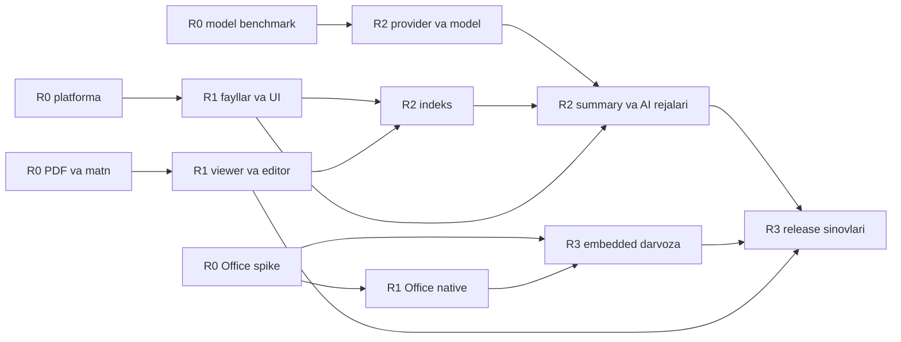

# Commandor — amalga oshirish va qabul rejasi

Versiya: 2.0 · 2026-11-07 · Rust implementatsiyasi uchun qayta tuzilgan reja, bajarilgan ish hisoboti emas. Talab IDlari [texnik topshiriq](TECHNICAL-SPEC.uz.md)dan olinadi.

## 1. Ish paketlari va bog‘liqliklar

| Bosqich | Ishlar | Chiqish dalili | Bog‘liqlik |
|---|---|---|---|
| R0.1 Platforma | Cargo workspace, egui oyna, UI crate lint chegarasi, `--worker` protokoli, rusqlite FTS5, portable-pty, uch OS CI build smoke | Har OSda `cargo test`, oyna ochilishi va build jurnali | Yo‘q |
| R0.2 Office feasibility | Headless render, private profile, macro block, native working-copy save, embedded spike | DOCX/XLSX/PPTX round-trip; process trace; embedded go/no-go jadvali | R0.1 |
| R0.3 Model feasibility | Qwen3.5-2B Q4_K_M, llama.cpp CPU/Metal va mavjud GPU, Uzbek summary benchmark | Runtime build/hash, xotira, latency va sifat jadvali | Sinov qurilmalari |
| R0.4 PDF/text | ropey+syntect editor spike (IME, 10 MB fayl), PDFium vs hayro/MuPDF render, lopdf sahifa amallari | Encoding, IME, annotation/page round-trip prototipi va dependency qarori | R0.1 |
| R1.1 Fayllar | Ikki panel/tab, buyruq paneli, volume, klaviatura, virtual list, copy/move queue, cancel, rename/trash | FS/UX acceptance; data-loss testlari | R0.1 |
| R1.2 Hujjatlar | Text edit, Markdown, PDF preview, Office preview/native edit, conflict/recovery | TXT/PDF-01/OFF-01–06/08; real fixturelar | R0.2/R0.4/R1.1 |
| R1.3 Terminal | Tanlangan papkada tashqi terminal, OS launch adapterlari | TERM-01, whitespace/Unicode/path-injection fixture | R1.1 |
| R2.1 Indeks | SQLite/FTS, roots/excludes, extractorlar, watcher/reconcile, search UI | IDX-01–04/06–08 | R1 hujjat brokeri |
| R2.2 AI/model | Providerlar, streaming/cancel, HF catalog/download, runtime lifecycle | AI-01–04/08–09 va MODEL-01–08 | R0.3 |
| R2.3 Summary/boshqaruv | Chunk summary, provenance, local-only policy, JSON tool plans, approval/audit | IDX-05, AI-05–07; injection va plan drift testlari | R2.1/R2.2/R1.1 |
| R2.4 Editor/terminal | PDF annotation/page operations, ichki PTY, syntax diagnostics | PDF-02/03, TXT-05/06, TERM-02–04 | R0.4/R1.2/R1.3 |
| R3.1 Embedded Office | Tanlangan adapter, focus/IME/clipboard, edit/save/recovery | OFF-07 barcha maqsadli OSda | R0.2 go + R1.2 |
| R3.2 Release | Accessibility, tarjima, NFR profiling, native packaging, signing, update/migration | Platforma test hisobotlari, installerlar, ma’lum cheklovlar | R1/R2 va Office darvozasi |

R0 Office spike asosiy riskni boshida tekshiradi; boshqa modullarni yozib bo‘lgandan keyin embedded qiyinchilikni kashf qilishga qoldirilmaydi. Uch OSda natija chiqmasa ochiq qaror yoziladi: embeddedga qo‘shimcha resurs, boshqa LibreOffice-family adapter yoki alohida native reliz scope. Bu hujjat foydalanuvchi nomidan native-only yakuniy scope’ni tasdiqlamaydi.

## 2. Mehnat hajmi bo‘yicha dastlabki taxmin

Quyidagi raqamlar muhandislik taxmini, narx taklifi yoki kalendar va’dasi emas. Kutubxona litsenziyalari/xizmat narxlari alohida tekshiriladi.

| Paket | Kishi-hafta taxmini |
|---|---:|
| R0 platforma/Office/model/PDF prototiplari | 3–5 |
| R1 ikki panel, fayl amallari, viewer/o‘z matn editori, native Office va terminal | 12–18 |
| R2 indeks/AI/model manager/PDF edit/PTY | 14–22 |
| R3 hardening, uch OS QA, packaging va hujjatlar | 6–10 |
| Embedded Office alohida integratsiya | 8–20+; R0dan keyin qayta baholanadi |
| **Jami** | **43–75+ kishi-hafta** |

3 tajribali muhandis va yarim/to‘liq stavkali QA bilan taxminan 4–7+ oy kalendar rejalashtirish diapazoni sifatida qaralishi mumkin; yo‘nalishlar to‘liq parallel emas. Embedded natija noaniqligi bu diapazonni uzaytirishi mumkin. Bir kishilik ishlab chiqishda muddatni shu sonni oddiy bo‘lish bilan hisoblash to‘g‘ri emas: kontekst, integratsiya va uch OS tekshiruvi qo‘shimcha vaqt oladi.

Rust ekotizimida tayyor web komponentlar (CodeMirror, PDF.js, xterm.js) yo‘qligi sababli editor va PDF viewer uchun R1 taxmini oshirildi.

Rollar: Rust GUI (egui); filesystem/native/Office; AI/index/runtime; QA/release. UX va texnik yozuv ishlari tegishli sprintga qo‘shiladi. Hech qanday tashqi jamoa yoki subagent hozir tayinlanmagan.

## 3. Talab → test guruhlari

| Test guruhi | Qoplanadigan IDlar | Qatlam |
|---|---|---|
| UI-A | UX-01–09 | Component, keyboard E2E, accessibility |
| FS-A | FS-01–08 | Unit, real temp filesystem, OS acceptance |
| TXT-A | TXT-01–06 | Byte round-trip, editor E2E, parser isolation |
| PDF-A | PDF-01–03 | Fixture render, save/reopen, memory profiling |
| OFFICE-A | OFF-01–09 | Runtime integration, visual diff + semantic comparison |
| TERM-A | TERM-01–04 | Native launch, PTY integration, resize/kill |
| AI-A | AI-01–09 | Mock contracts, local runtime, adversarial plan tests |
| IDX-A | IDX-01–08 | DB transaction, reconciliation, query relevance, purge |
| MODEL-A | MODEL-01–08 | Fake HTTP downloads, checksum/resume, real inference |
| PERF-A | NFR-01–10 | Baseline metrics, process/network traces, crash injection |

Keyingi deb belgilangan FS-09/10 va IDX-09 birinchi final release mezoniga kirmaydi. Har requirement bo‘yicha test case → build → OS → natija → artifact zanjiri saqlanadi. Table oralig‘i “hammasi o‘tdi” degani emas; implementatsiya vaqtida har IDga alohida evidence biriktiriladi.

## 4. Majburiy qabul ssenariylari

| Test | Vaziyat va amal | Kutiladigan dalil |
|---|---|---|
| A01 | Ikki panel turli katalogda; chapdan o‘ngga 1 000 fayl copy; mavjud target bor | Conflict UI, to‘g‘ri progress; ruxsatsiz overwrite yo‘q |
| A02 | Katta copy o‘rtasida cancel/disk full/USB uzilishi | Asl manba butun; partiallar aniq; jurnal qayta ochilganda tushunarli |
| A03 | Symlink sikli, tashqi rootga symlink, hardlink, case-only rename | Sikl yo‘q; capability tekshiruvi; metadata/link siyosati saqlanadi |
| A04 | UTF-8 BOM, CRLF, Unicode filename, 10 MB matn, noma’lum encoding | Byte/EOL saqlanishi yoki aniq limit; jim buzilish yo‘q |
| A05 | Fayl editor ochilgandan keyin boshqa dasturda o‘zgardi | Conflict; originalni bosib yozish yo‘q; Save As mavjud |
| A06 | DOCX/XLSX/PPTXni ochish va Editni bosmaslik | Headless render bo‘lishi mumkin; GUI editor yo‘q; original hash o‘zgarmagan |
| A07 | Shu faylni qayta ochish; keyin manbani o‘zgartirib ochish | Cache hit; yangi revisionda invalidate; eski render kech kelsa qabul qilinmaydi |
| A08 | Office Edit → working copy Save → originalga apply → reopen | Formatdagi haqiqiy o‘zgarish, yangi preview, engine/version provenance |
| A09 | Embedded Office: focus, IME, copy/paste, resize va crash | Windows/macOS/Linuxda real video/log; data recovery; OFF-07 gate |
| A10 | Macro-enabled, external-linkli, parolli va buzilgan Office fayllari | Makro sentinel ishlamagan; tashqi so‘rov yo‘q; boshqariladigan xato |
| A11 | 100 sahifa PDF preview; highlight/note/rotate/reorder Save As | Boshqa viewerda qayta ochish; sahifa soni/tartibi va izohlar to‘g‘ri |
| A12 | Tanlangan papkada tizim va ichki terminal | `pwd`/`Get-Location`, Ctrl+C, resize; maxsus belgili path kodga aylanmagan |
| A13 | Tanlangan rootni skan; exclude va symlink; app restart | Faqat doiradagi fayllar; indeks saqlangan; ruxsat xatolari hisoblangan |
| A14 | Watcher event yo‘qotish, fayl rename/delete, offline disk | Reconciliation tiklaydi; offline deleted emas; stale summary belgilangan |
| A15 | Uzun hujjat summarysi; keyin hujjat/model/promptni o‘zgartirish | Chunk coverage, manba locatorlari, provenance va stale invalidation |
| A16 | Local summaryga remote URL yoki HTTP redirect berish | Policy rad etadi; bulutga fallback va data upload yo‘q |
| A17 | AIga “fayllarni ko‘chir” so‘rovi; hujjatda zararli ko‘rsatma | Faqat schema reja; tasdiqsiz mutatsiya yo‘q; hujjat vakolat bermaydi |
| A18 | Tasdiqdan oldin source/targetni o‘zgartirish; bir so‘rovni 2 marta yuborish | Plan drift/conflict, idempotency, to‘g‘ri per-item journal |
| A19 | GGUF downloadni uzish/resume; revision/hash noto‘g‘ri | Noto‘g‘ri artifact installed emas; partial ishonchli davom etadi yoki restart |
| A20 | llama.cpp start, port busy, unsupported model, OOM, app close | Healthga asoslangan ready, aniq xato, owned process cleanup |
| A21 | Tarmoqni uzib core, Office va local model ishlatish | Oldindan o‘rnatilgan runtime/model bilan to‘liq offline oqim |
| A22 | Rootni purge, provider keyni olib tashlash, diagnostic export | Derived data tozalangan; logda secret/content canary yo‘q |
| A23 | SQLite migration paytida crash va disk full | Oldingi DB tiklanadi; partial migratsiya current deb olinmaydi |
| A24 | OS installer/update/uninstall; ochiq dirty session bor | Update kechiktiriladi; recovery saqlanadi; user docs o‘chirilmaydi |

## 5. Fixture va AI sifat protokoli

Fixturelar sintetik yoki foydalanish huquqi bor fayllardan tuziladi. Shaxsiy foydalanuvchi diskini CI/test korpusi sifatida ishlatish mumkin emas. Har format uchun kamida: oddiy, murakkab, katta, parolli/buzilgan, Unicode va tashqi resursli namuna. Office visual diff bir xil font/environmentda olinadi; semantic assertions matn, formula, sheet/slide sonini mustaqil tekshiradi.

Qwen nomzodi uchun boshlang‘ich korpus: kamida 50 ta o‘zbekcha/ruscha/inglizcha qisqa va uzun hujjat; 100 ta tabiiy til file-search/operation so‘rovi. Kamida bir o‘zbek tilini biluvchi baholovchi sourcega tayanganlik, asosiy faktlar qamrovi va til ravonligini baholaydi. Schema/permission tekshiruvi avtomatik; biznes semantikasi inson tekshiruvi bilan.

Boshlang‘ich sifat darvozasi: mutatsiya bo‘yicha policy bypass — **0**; testlarda ruxsatsiz shell/data upload — **0**; search plan va argumentlarning semantik to‘g‘riligi ≥90% maqsad. Summaryda muhim summa/sana/ismni uydirish test korpusida **0** bo‘lishi kerak; boshqa faktik da’volardan manba bilan tasdiqlanmaganlari ≤2% maqsad (baholovchi har da’voni source bilan belgilaydi). Benchmark o‘tmaguncha model “tavsiya etilgan” emas, “sinov nomzodi” sifatida chiqadi. Past natijada model/context/prompt qayta tanlanadi, foydalanuvchiga yashirin kuchli bulut modeliga o‘tilmaydi.

Model hisoboti: repo+commit+quantization+hash, llama.cpp build, context, thread/GPU layer, OS/CPU/GPU/RAM, cold/warm latency, token/s, peak RSS/VRAM, test korpusi versiyasi. Benchmark generatsiya sifati, tool schema sifati va retrieval sifatini alohida baholaydi.

## 6. Risklar va qaror nuqtalari

| Risk | Ta’sir | Kamaytirish va qaror nuqtasi |
|---|---|---|
| Embedded Office uch OSda murakkab | Eng katta scope/muddat riski | R0 spike; working native fallback; OFF-07ni ochiq gate sifatida saqlash |
| Office round-trip layout/formula yo‘qotishi | Hujjat buzilishi | Fixture, backup, Save As, feature-specific cheklov |
| Kichik model Uzbek/structured output sifati | Noto‘g‘ri topish/reja | Benchmark, schema validation, deterministik broker, model alternatives |
| llama.cpp model support o‘zgarishi | Model ochilmasligi | Pinlangan runtime/model manifest; support matrix va smoke |
| Index/Office/AI bir payt resurs ishlatishi | RAM bosimi, UI sekinlashishi | Worker queue, priority, idle unload, memory budget |
| Fayl amallarida platforma farqlari | Data loss va metadata yo‘qolishi | Real OS fixture, transaction journal, fsync/backup, explicit conflict |
| Parser/model supply chain | Begona content yoki dependency zaifligi | Pin/checksum, parser isolation, signed runtime, SBOM va update |
| Model/cache juda katta | Disk to‘lishi | Oldindan hajm/bo‘sh joy, quota, LRU, partial cleanup |
| Provayder/local server aslida remote proxy | Maxfiy ma’lumot tashqariga chiqishi | Managed-local default; locality yorlig‘i va explicit attachment policy |
| egui’da IME, katta matn yoki accessibility yetishmasligi | Editor/a11y talablari bajarilmasligi | R0.4 spike; ADR-001 qayta ko‘rish sharti — `iced` prototipi |
| Native binary/litsenziya tarqatish | Release bloklanishi | Har komponentning aniq release/litsenziyasi va noticesini tekshirish |

Litsenziya bo‘yicha bu hujjat yuridik xulosa bermaydi. Release oldidan Rust crate’lar (`cargo deny`/`cargo about` inventari), PDFium, LibreOffice/llama.cpp, qo‘shimcha PDF/Office SDK, model weights va fontlarning aynan tarqatiladigan versiyalari inventar qilinadi. Asosiy ilova litsenziyasi va monetizatsiya hali tanlanmagan; texnik arxitektura bu qarorni oldindan belgilamaydi.

## 7. Release ta’rifi

Release tayyor deb belgilanishi uchun:

1. Talab/test matritsasida tegishli relizning barcha majburiy IDlari dalil bilan yopilgan.
2. Uch OSda installer va birinchi ishga tushirish; boshqa foydalanuvchi profili va offline oqim sinovdan o‘tgan.
3. Data loss, ruxsatsiz fayl mutatsiyasi, secret leak bo‘yicha ochiq kritik/yuksak xato qolmagan.
4. Macro bloklash, AI plan drift, downloader integrity va DB recovery testlari o‘tgan.
5. Performance natijalari maqsad/baseline bilan taqqoslangan; farqlar yozilgan va scope/baseline qarori ochiq.
6. README, foydalanish qo‘llanmasi, recovery/migration ko‘rsatmasi, model/runtime support matrix va known limitations mavjud.
7. Imzolash/notarization va update jarayoni sinovdan o‘tgan; downgrade/migratsiya cheklovi aniq.
8. OFF-07 holati alohida ko‘rsatilgan; native-only variant to‘liq embedded mahsulot deb chiqarilmagan.

2026-11-07 holati: implementatsiya boshlandi. Kichik vazifalar va haqiqiy tekshiruv dalillari [TODO va hisobotlar](../TODO.md)da yuritiladi. Yuqoridagi A01–A24 to‘liq qabul ssenariylari shu yerda reja sifatida qoladi; bazaviy prototip sinovi ularning barchasi bajarilganini anglatmaydi.
